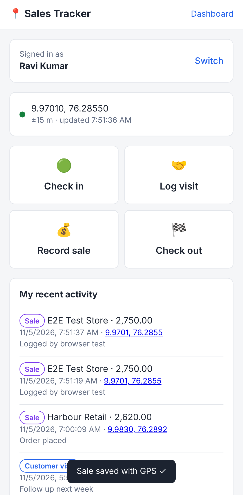
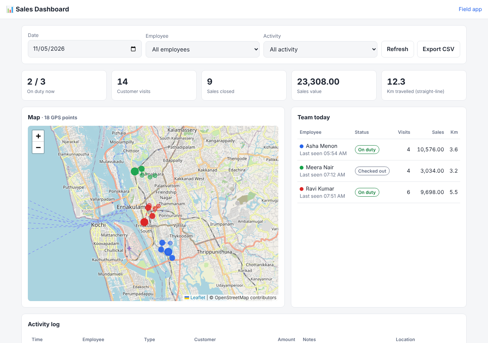

# Sales Tracker

A simple app for tracking field sales employees. Every check-in, customer visit and sale is tagged with the rep's GPS location.

- **Field app** (`/`): a phone-friendly page for sales reps. They pick their name once, then tap **Check in**, **Log visit**, **Record sale** or **Check out**. Each entry gets the phone's current GPS coordinates and accuracy.
- **Dashboard** (`/admin`): the manager's view.
  - A live map with every GPS point and each rep's route for the day.
  - Per-rep status (on duty / checked out / not started), visits, sales value and distance travelled.
  - A full activity log, CSV export, and employee management.

| Field app | Dashboard |
|---|---|
|  |  |

## Run it

Requires **Node.js 22.13+**. It uses Node's built-in SQLite, so there's no database to install.

```bash
npm install
npm start
```

Open http://localhost:3000/admin and add your employees. Reps then open http://localhost:3000/ on their phones.

To try it with demo data:

```bash
npm run seed
```

### Configuration

| Variable | Default | Purpose |
|---|---|---|
| `PORT` | `3000` | HTTP port |
| `DB_PATH` | `data/tracker.db` | SQLite database file |
| `ADMIN_PASSWORD` | *(empty)* | When set, the dashboard and its APIs require HTTP Basic auth (any username, this password). The field app stays open so reps can log without a password. |

```bash
ADMIN_PASSWORD=change-me PORT=8080 npm start
```

### GPS needs HTTPS

Browsers only share location with pages served over **HTTPS** (or `localhost`). When you deploy, put the app behind HTTPS, for example:

- a reverse proxy such as Caddy or nginx with Let's Encrypt, or
- a hosting platform that provides TLS.

For a quick test on a real phone, a tunnel such as `cloudflared tunnel --url http://localhost:3000` gives you a temporary HTTPS URL.

## API

| Method & path | Auth | Description |
|---|---|---|
| `GET /api/employees` | – | Active employees (`?all=1` includes inactive) |
| `POST /api/employees` | admin | Add `{ name, phone?, region? }` |
| `PATCH /api/employees/:id` | admin | Update name / phone / region / `active` |
| `POST /api/activities` | – | Log `{ employee_id, type, lat, lng, accuracy?, customer?, amount?, notes? }` |
| `GET /api/employees/:id/activities` | – | One rep's recent entries |
| `GET /api/activities` | admin | Filter with `date`, `tz`, `employee_id`, `type`, `limit` |
| `GET /api/summary?date=&tz=` | admin | Per-rep daily totals and last known location |
| `GET /api/export.csv` | admin | Same filters as `/api/activities`, as CSV |

`type` is one of `check_in`, `visit`, `sale`, `check_out`.

- Visits and sales need a `customer`, and sales need an `amount`.
- `date` is `YYYY-MM-DD` in the viewer's timezone.
- `tz` is the browser's `Date#getTimezoneOffset()` in minutes.

## Tests

```bash
npm test
```

## Limitations (it's meant to be simple)

- Reps identify themselves by picking their name. There are no per-rep logins, so treat the field app as trusted-team-only.
- Locations are recorded only when a rep logs something. There's no background tracking, since browsers can't track a closed page.
- "Km travelled" is the straight-line distance between consecutive logged points, not the road distance.
